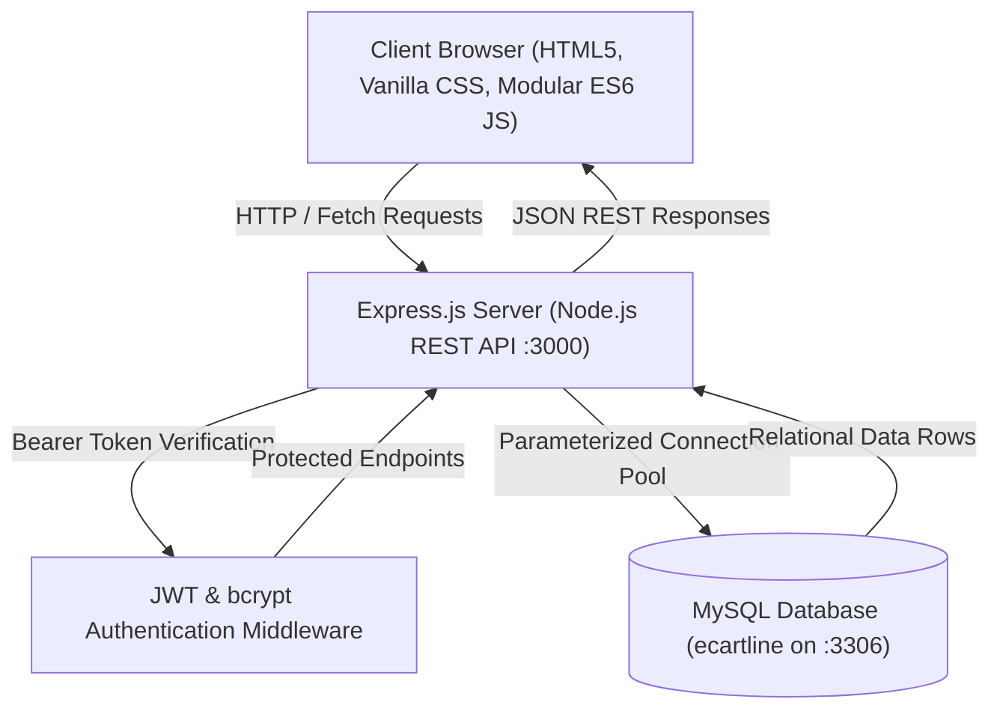

<div align="center">

# 🛍️ ECartline — Full-Stack E-Commerce Platform

**A modern, responsive, and feature-rich full-stack e-commerce web application inspired by the usability of Amazon & Flipkart, built with Vanilla JavaScript, Node.js, Express, and MySQL (XAMPP / MariaDB).**

[](https://nodejs.org/)
[](https://expressjs.com/)
[](https://www.mysql.com/)
[](https://developer.mozilla.org/en-US/docs/Web/JavaScript)
[](LICENSE)

[Live Demo](http://localhost:3000) • [Explore Features](#-key-features) • [Installation Guide](#-quick-start-guide) • [API Documentation](#-rest-api-documentation) • [Admin Portal](#-admin-dashboard)

</div>

---

## 📖 Table of Contents

- [Overview](#-overview)
- [Key Features](#-key-features)
- [System Architecture](#-system-architecture)
- [Technology Stack](#-technology-stack)
- [Product Catalog Showcase](#-product-catalog-showcase)
- [Quick Start Guide](#-quick-start-guide)
- [Environment Configuration](#-environment-configuration)
- [Database Setup & Schema](#-database-setup--schema)
- [REST API Documentation](#-rest-api-documentation)
- [Admin Dashboard](#-admin-dashboard)
- [Project Directory Structure](#-project-directory-structure)
- [Troubleshooting & FAQ](#-troubleshooting--faq)
- [Contributing & License](#-license)

---

## 🌟 Overview

**ECartline** is an end-to-end e-commerce solution designed to deliver a seamless shopping experience. It combines a clean, modern user interface with a robust, production-grade Node.js/Express backend and a normalized relational MySQL database.

The application features **49 dynamic products across 12 categories**, complete with flagship smartphones (including **Samsung Galaxy S24/S23 Ultra** and the **Apple iPhone 16/15/14/13 lineup**), laptops, electronics, home essentials, sports gear, and fashion.

---

## 🚀 Key Features

### 🛒 Customer Storefront
* **Dynamic Home Page**:
  * Hero carousel with automated slide transitions.
  * Curated merchandising sections: *Today's Top Deals*, *Flagship Mobiles & Gadgets*, *Best Sellers*, and *Highest Rated by Customers*.
  * "Shop by Category" circular grid with responsive touch interactions.
* **Smart Search & Live Autocomplete**:
  * Case-insensitive, tokenized search across product titles, categories, and descriptions.
  * Live debounced auto-suggestions dropdown with product thumbnail, category, rating, and real-time price.
* **Flipkart/Amazon-Style Filter System**:
  * Category selector with real-time product counts.
  * Price range presets alongside **custom Min and Max price inputs with an "Apply" button**.
  * Customer rating filter (4★ & above, 3★ & above).
  * Discount filtering (10%+, 20%+, 30%+, 50%+).
  * In-stock availability checkbox.
  * **Dismissible active filter chips** for single-click filter removal.
  * Sorting by: *Featured*, *Price: Low to High*, *Price: High to Low*, *Customer Rating*, *Newest*, and *Discount*.
* **Interactive Product Details Page**:
  * High-resolution primary image with clickable multi-angle thumbnail gallery.
  * Bank Offers card highlighting instant card cashback and coupon promotions.
  * Delivery postal pincode checker with instant delivery estimate.
  * Strict quantity selector bounded by real-time MySQL inventory.
  * Verified buyer reviews section with 5-star interactive rating submission.
* **Persistent Cart & Wishlist**:
  * Synchronized per-user in MySQL for logged-in accounts, with seamless `localStorage` fallback for guests.
  * Automated guest cart merging upon login.
  * "Save for Later" quick-move action between Cart and Wishlist.
  * Out-of-stock guards blocking invalid checkout submissions.
* **Multi-Step Checkout & Orders**:
  * Saved address book with full validation (recipient name, 10-digit mobile, street, city, state, pincode).
  * Transparent payment options: Cash on Delivery (COD), UPI on Delivery, and Card on Delivery.
  * Atomic stock decrement inside database transactions (`BEGIN TRANSACTION`, `COMMIT`, `ROLLBACK`).
  * Visual order status tracker (`Placed` ➔ `Processing` ➔ `Shipped` ➔ `Delivered`).
  * Self-service order cancellation with automatic inventory restoration.

### ⚡ Admin & Operations Portal
* Overview analytics: total revenue, order volume, catalog inventory count, registered users.
* Real-time Product Catalog Management (Add, Edit, Delete, Stock Update).
* Order fulfillment management: update delivery status and payment statuses.

---

## 🏗️ System Architecture



---

## 🛠️ Technology Stack

| Layer | Technologies Used |
|---|---|
| **Frontend** | Vanilla HTML5, Modern CSS3 (Grid, Flexbox, Custom Properties), Vanilla JavaScript (ES6+ Modules, Fetch API) |
| **Backend** | Node.js, Express.js |
| **Database** | MySQL 8.0 / MariaDB (XAMPP Compatible) via `mysql2/promise` connection pool |
| **Authentication** | JSON Web Tokens (`jsonwebtoken`), `bcryptjs` password hashing |
| **Security** | Parameterized SQL queries, CORS configuration, input sanitization |
| **Tooling & Scripts** | npm scripts, Windows `.bat` launchers, automated MySQL seed scripts |

---

## 📱 Product Catalog Showcase

The database is pre-seeded with **49 accurate products** across 12 distinct categories. High-resolution, authentic photos and multi-image galleries are mapped to each item:

| Category | Example Flagship Products | Price Range |
|---|---|---|
| **Mobiles** | Samsung Galaxy S24 Ultra 5G, Apple iPhone 16 Pro Max, iPhone 15, OnePlus Nord CE4, Redmi Note 13 5G | ₹12,999 – ₹1,44,900 |
| **Electronics** | HP 15 Thin & Light Laptop, JBL Flip Waterproof Speaker, boAt Rockerz 450, Noise ColorFit Pro 4 | ₹1,299 – ₹42,990 |
| **Fashion** | Men's Cotton Casual Shirt, Women's Floral Rayon Kurti, Slim Fit Stretch Denim Jeans, Classic Analog Watch | ₹649 – ₹2,499 |
| **Footwear** | Pro Cushioned Running Shoes, Casual White Minimalist Sneakers, Genuine Leather Formal Oxford Shoes | ₹1,499 – ₹2,799 |
| **Home & Kitchen** | Non-Stick 5-Piece Cookware Set, 750W Mixer Grinder, Digital 4L Air Fryer, 144 TC Cotton Bedsheet Set | ₹699 – ₹4,999 |
| **Sports & Fitness** | Kashmir Willow Cricket Bat, 20kg Adjustable Dumbbells, Anti-Skid 6mm Yoga Mat, Training Football | ₹599 – ₹3,499 |
| **Beauty & Care** | Vitamin C Brightening Face Serum, Matte Lipstick 6-Combo, 2000W Salon Hair Dryer | ₹499 – ₹1,299 |
| **Toys & Games** | 500-Piece Building Blocks, High-Speed RC Racing Car, Family Classic Board Games Collection | ₹599 – ₹1,499 |
| **Furniture** | High-Back Ergonomic Office Chair, Engineered Wood Study Desk, Modern 3-Seater Fabric Sofa | ₹5,499 – ₹18,999 |
| **Outdoor & Travel** | 2-Person Waterproof Camping Tent, 60L Technical Trekking Rucksack, Insulated Sleeping Bag | ₹1,599 – ₹3,499 |
| **Bags** | Water-Resistant Laptop Backpack 30L, Travel Duffle with Shoe Compartment, Casual Crossbody Sling | ₹599 – ₹1,799 |
| **Accessories** | UV400 Polarized Sunglasses, Slim RFID-Safe Leather Wallet, Digital Waterproof Sports Watch | ₹499 – ₹1,199 |

---

## ⚡ Quick Start Guide

### Prerequisites
1. **[Node.js](https://nodejs.org/)** (v16.x or newer).
2. **[XAMPP](https://www.apachefriends.org/)** (for Apache & MySQL on Windows).

---

### Step 1: Clone the Repository
```bash
git clone https://github.com/jishwar801-a11y/YOUR_REPO_NAME.git
cd YOUR_REPO_NAME
```

### Step 2: Start XAMPP MySQL
1. Launch **XAMPP Control Panel**.
2. Click **Start** next to **MySQL** (Default port `3306`).

### Step 3: Install Dependencies
From the project root:
```bash
cd ECartline/backend
npm install
cd ../..
```

### Step 4: Configure Environment Variables
Copy `.env.example` in `ECartline/backend/` to `.env`:
```powershell
copy ECartline\backend\.env.example ECartline\backend\.env
```
*(Default XAMPP configuration with user `root` and blank password works out of the box).*

### Step 5: Initialize the Database
Run the automated database setup and seeding script:
```bash
npm run setup
```
*(Alternatively, import `ecartline.sql` directly in phpMyAdmin at `http://localhost/phpmyadmin`).*

### Step 6: Start the Server
```bash
npm start
```
*(Or double-click `start-project.bat` from Windows Explorer).*

Now open your browser at:
* 🌐 **Storefront**: [http://localhost:3000](http://localhost:3000)
* 📋 **Product Catalog**: [http://localhost:3000/products.html](http://localhost:3000/products.html)
* ⚡ **Admin Portal**: [http://localhost:3000/admin.html](http://localhost:3000/admin.html)

---

## ⚙️ Environment Configuration

Configuration is managed via `ECartline/backend/.env`:

```env
# Server Port
PORT=3000

# MySQL / MariaDB Connection (Default XAMPP credentials)
DB_HOST=localhost
DB_PORT=3306
DB_USER=root
DB_PASSWORD=
DB_NAME=ecartline

# JWT Authentication
JWT_SECRET=super_secret_ecartline_jwt_key_2026
JWT_EXPIRES_IN=7d

# Default Administrator Seed Credentials
ADMIN_NAME=ECartline Admin
ADMIN_EMAIL=admin@ecartline.in
ADMIN_PASSWORD=Admin@12345
```

---

## 🗄️ Database Setup & Schema

The database consists of 9 relational tables:

```text
ecartline
├── users               # Registered customer and administrator accounts
├── products            # Catalog items with pricing, inventory, rating, and image galleries
├── cart_items          # Persistent user shopping cart items
├── addresses           # User delivery address book
├── orders              # Placed customer orders with totals and delivery details
├── order_items         # Itemized lines within each order
├── wishlist_items      # Saved products for user accounts
├── reviews             # Product star ratings and written reviews
└── contact_messages    # Contact form inquiries
```

---

## 🔌 REST API Documentation

### Authentication (`/api/auth`)
| Method | Endpoint | Description | Auth Required |
|---|---|---|---|
| `POST` | `/api/auth/register` | Register a new customer account | No |
| `POST` | `/api/auth/login` | Login with email/mobile & password; returns JWT | No |
| `GET` | `/api/auth/me` | Fetch currently authenticated user profile | Yes |
| `PUT` | `/api/auth/profile` | Update profile information | Yes |
| `PUT` | `/api/auth/change-password` | Change account password | Yes |

### Products (`/api/products`)
| Method | Endpoint | Description | Auth Required |
|---|---|---|---|
| `GET` | `/api/products` | Query products with category, q, price, rating, & discount filters | No |
| `GET` | `/api/products/suggestions?q=` | Live autocomplete search suggestions | No |
| `GET` | `/api/products/:id` | Get complete details and gallery for a single product | No |
| `POST` | `/api/products` | Create a new product | Admin |
| `PUT` | `/api/products/:id` | Update product fields or stock | Admin |
| `DELETE`| `/api/products/:id` | Remove a product from the catalog | Admin |

### Cart (`/api/cart`)
| Method | Endpoint | Description | Auth Required |
|---|---|---|---|
| `GET` | `/api/cart` | Get current user's cart items from MySQL | Yes |
| `POST` | `/api/cart` | Add product to cart with quantity check | Yes |
| `POST` | `/api/cart/merge` | Merge guest `localStorage` cart upon login | Yes |
| `PUT` | `/api/cart/:productId` | Set exact quantity (capped by stock) | Yes |
| `DELETE`| `/api/cart/:productId` | Remove a single item from cart | Yes |
| `DELETE`| `/api/cart` | Clear all items from cart | Yes |

### Orders (`/api/orders`)
| Method | Endpoint | Description | Auth Required |
|---|---|---|---|
| `POST` | `/api/orders` | Place order (validates stock, creates order, decrements inventory) | Yes |
| `GET` | `/api/orders` | List customer's orders | Yes |
| `GET` | `/api/orders/:id` | Get single order tracking details and item lines | Yes |
| `PUT` | `/api/orders/:id/cancel` | Cancel order & restore inventory in MySQL | Yes |
| `GET` | `/api/orders/admin/all` | Admin list of all orders across the system | Admin |
| `PUT` | `/api/orders/admin/:id/status`| Admin update order & payment status | Admin |

### Reviews & Wishlist (`/api/reviews`, `/api/wishlist`)
| Method | Endpoint | Description | Auth Required |
|---|---|---|---|
| `GET` | `/api/reviews/product/:id` | Fetch verified reviews and average rating | No |
| `POST` | `/api/reviews` | Submit a star rating and comment | Yes |
| `GET` | `/api/wishlist` | Fetch user's saved wishlist items | Yes |
| `POST` | `/api/wishlist/:id` | Add item to wishlist | Yes |
| `DELETE`| `/api/wishlist/:id` | Remove item from wishlist | Yes |

---

## ⚡ Admin Dashboard

Log in at **[http://localhost:3000/login.html](http://localhost:3000/login.html)** using:
* **Email**: `admin@ecartline.in`
* **Password**: `Admin@12345`

The Admin Portal (**`admin.html`**) provides:
* **Live Catalog Control**: Instantly modify prices, update stock, or add new models without touching code.
* **Order Management**: Transition orders between `Placed`, `Processing`, `Shipped`, and `Delivered`.
* **Inventory Alerts**: Identify low-stock items at a glance.

---

## 📁 Project Directory Structure

```text
ECartline-with-backend/
├── ECartline/
│   ├── backend/
│   │   ├── config/
│   │   │   └── db.js                 # MySQL connection pool
│   │   ├── db/
│   │   │   ├── products-seed.json    # 49 seed products with galleries
│   │   │   ├── schema.sql            # Table definitions & indexes
│   │   │   └── setup.js              # Database initialization script
│   │   ├── middleware/
│   │   │   └── auth.js               # JWT & Admin role verification
│   │   ├── routes/                   # Modular REST route handlers
│   │   │   ├── addresses.js
│   │   │   ├── auth.js
│   │   │   ├── cart.js
│   │   │   ├── contact.js
│   │   │   ├── orders.js
│   │   │   ├── products.js
│   │   │   ├── reviews.js
│   │   │   └── wishlist.js
│   │   ├── server.js                 # Express application entry point
│   │   ├── package.json
│   │   ├── .env.example
│   │   └── .gitignore
│   ├── css/
│   │   └── style.css                 # Comprehensive responsive design system
│   ├── js/
│   │   ├── api.js                    # Client HTTP connectors & auth state
│   │   ├── app.js                    # Main UI, navigation, filters, product details
│   │   ├── auth.js                   # Client login & registration handlers
│   │   ├── cart.js                   # Cart operations & offline fallback
│   │   └── products.js               # Seed fallback catalog
│   ├── index.html                    # Storefront & merchandising sections
│   ├── products.html                 # Catalog, multi-term search, and sidebar filters
│   ├── product-details.html          # Interactive gallery, bank offers, reviews
│   ├── cart.html                     # Two-column shopping cart & price summary
│   ├── checkout.html                 # 3-step address, payment & order placement
│   ├── orders.html                   # Order history & visual status tracking
│   ├── wishlist.html                 # Saved items showcase
│   ├── profile.html                  # Customer profile & address book management
│   ├── admin.html                    # Admin dashboard & inventory manager
│   ├── login.html                    # Customer / admin sign in
│   ├── register.html                 # Customer registration
│   ├── contact.html                  # Customer support inquiries
│   └── about.html                    # Brand story & company info
├── ecartline.sql                     # Full MySQL export for phpMyAdmin import
├── start-project.bat                 # 1-click launcher for Windows
├── setup-database.bat                # 1-click database creator
├── fix-xampp-mysql.bat               # XAMPP MariaDB repair utility
├── package.json                      # Root launcher script
├── .gitignore                        # Git exclusion rules (node_modules, .env)
└── README.md                         # Project documentation
```

---

## 🔧 Troubleshooting & FAQ

#### 1. MySQL throws `ETIMEDOUT` or crashes in XAMPP
A known bug in MariaDB creates corrupted `.info` files inside `C:\xampp\mysql\data`. Run the built-in repair script:
```powershell
.\fix-xampp-mysql.bat
```
Then restart MySQL from the XAMPP Control Panel.

#### 2. Images are not displaying
All product photos use reliable Unsplash image links. Ensure you have an active internet connection so the browser can load the images. If offline, the built-in SVG placeholder fallback automatically displays.

#### 3. How do I reset the product catalog to default?
Run:
```bash
npm run setup
```
This re-runs `setup.js` and synchronizes all 49 products with the latest prices and images.

---

## 📄 License

This project is licensed under the **MIT License**. Feel free to use, modify, and distribute for personal or commercial projects.

<div align="center">
  <b>Built with ❤️ for ECartline</b>
</div>
